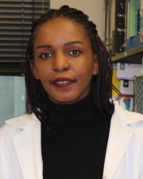
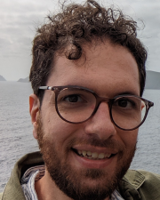

The Data Science for Biology workshop series is organized by Afrah Khairallah
and Joseph Elsherbini, with primary support from the Vaginal Microbiome
Research Consortium (VMRC).

## Organizers

::: {.grid}

::: {.g-col-2}
{fig-align="left"}
:::
::: {.g-col-4}
**Dr. Afrah Khairallah** \
Postdoctoral Research Fellow \
Africa Health Research Institute (AHRI) - UKZN
:::

::: {.g-col-2}
{fig-align="left"}
:::
::: {.g-col-4}
**Dr. Joseph Elsherbini** \
Data Scientist \
Ragon Institute of MGB, MIT and Harvard
:::

:::

## Teaching teams

Each workshop brings together its own group of instructors, teaching
assistants and speakers.

- [Workshop 2: Multiomics: Microbiome and Host Gene Expression (November 2026)](materials/2-workshop2/team.qmd)
- [Workshop 1: Data Science with R and Agentic Coding (June 2026)](materials/1-workshop1/team.qmd)
- [2024 workshops](past-workshops.qmd#teaching-teams)

## About these materials

This website started with the code from Andrew P. Bray's workshop website and much of the R content has been remixed and adapted from SDS375, a course by Claus O. Wilke.
