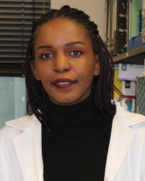
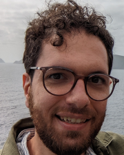
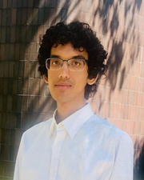

::: {.grid}

::: {.g-col-2}
{fig-align="left"}
:::
::: {.g-col-4}
[*Series Organizer and Instructor*]{style="font-size: 0.8em"} \
**Dr. Afrah Khairallah** \
Postdoctoral Research Fellow \
Africa Health Research Institute (AHRI) - UKZN
:::

::: {.g-col-2}
{fig-align="left"}
:::
::: {.g-col-4}
[*Series Organizer and Instructor*]{style="font-size: 0.8em"} \
**Dr. Joseph Elsherbini** \
Data Scientist \
Ragon Institute of MGB, MIT and Harvard
:::

::: {.g-col-2}
{fig-align="left"}
:::
::: {.g-col-4}
[*Instructor*]{style="font-size: 0.8em"} \
**Dr. Scott Handley** \
Professor, Pathology & Immunology \
Director of Agentic AI, McDonnell Genome Institute
:::

::: {.g-col-2}
{fig-align="left"}
:::
::: {.g-col-4}
[*Instructor*]{style="font-size: 0.8em"} \
**Bertha Baye** \
Bioinformatician \
Centre for the AIDS Programme of Research in South Africa (CAPRISA) - UKZN
:::

::: {.g-col-2}
{fig-align="left"}
:::
::: {.g-col-4}
[*Instructor*]{style="font-size: 0.8em"} \
**Dr. Kris Sankaran** \
Assistant Professor, Statistics \
University of Wisconsin
:::

::: {.g-col-2}
{fig-align="left"}
:::
::: {.g-col-4}
[*Instructor*]{style="font-size: 0.8em"} \
**Marothi Peter Letsoalo** \
Senior Biostatistician \
Africa Health Research Institute (AHRI) - UKZN
:::

::: {.g-col-2}
{fig-align="left"}
:::
::: {.g-col-4}
[*Keynote Speaker*]{style="font-size: 0.8em"} \
**Dr. Lenine Liebenberg** \
Chief Researcher \
Centre for Epidemic Response and Innovation (CERI) - Stellenbosch
:::

:::
