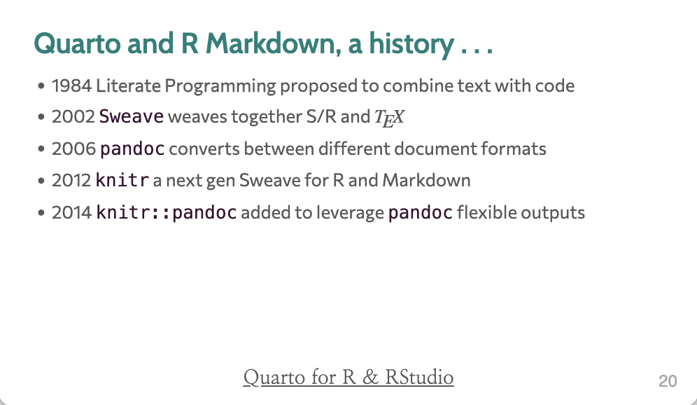
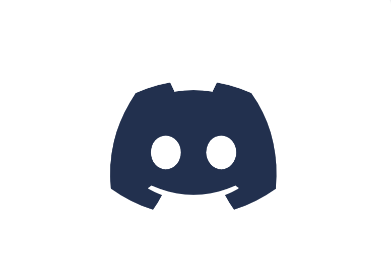
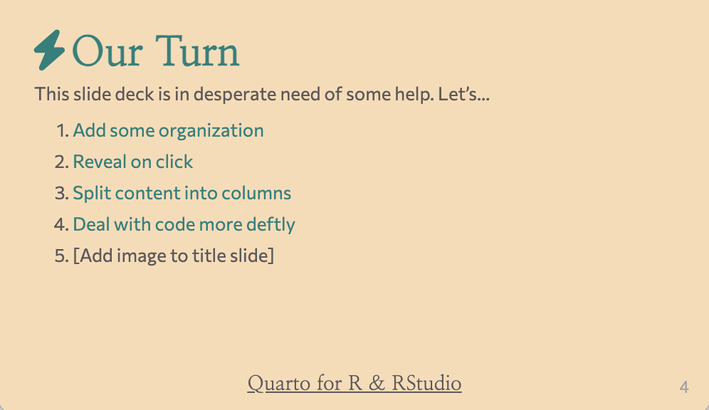
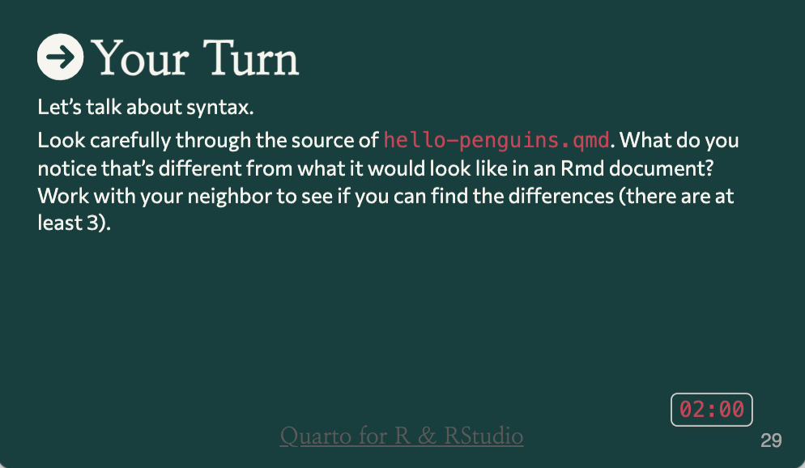

```{r setup, include=FALSE}
library(tidyverse)
library(patchwork)
pal <- c(navy = "#2b3a67", teal = "#2a9d8f", orange = "#e76f51",
         gold = "#e9c46a", grey = "#bbbbbb")
theme_set(theme_minimal(base_size = 15))
set.seed(2026)
```

## {data-menu-title="Wi-Fi"}

\
\

### Wi-Fi {style="font-size: 2.5em; text-align: center"}

::: {style="font-size: 1.5em; text-align: center"}
Network: **Golden_Tulip**

Click on **Conference**

Password: **Diamond254**
:::

## {data-menu-title="Workshop Goals"}

\
\

### Goals for this session {style="font-size: 2.5em; text-align: center"}

::: {.incremental style="font-size: 1.5em"}
1. Get to know your instructors and neighbors

2. Set expectations for the week

3. Meet the study and the data we'll work on all week

4. Get excited!
:::

## Nairobi, 9 to 13 November 2026 {.center}

Golden Tulip Westlands

61 of us, from 12 countries

## Who is in the room {.your-turn}



## Meet the team {.center}

Please stand up and introduce yourselves:

1. Instructors
2. Teaching assistants
3. Logistics and support

Everyone's name and institution is on the [team page](../team.qmd){target="_blank"}.

## Let's make this workshop work for all

::: {.incremental style="font-size: 1.2em"}
1. You belong here. This workshop is intended for a wide-audience with a focus on beginners. If you feel out of place - it's our problem, not yours!

2. Stay committed. This week-long workshop is intended to build each day and leave you with skills you can really use. Commit to stay engaged for best results, for you and your group!

3. This is a challenging but friendly environment. We are here to learn and grow. In order to make the right environment please follow "[the 4 social rules](https://www.recurse.com/social-rules)" and [code-of-conduct](https://docs.carpentries.org/topic_folders/policies/code-of-conduct.html).
:::

## The week

```{r}
#| fig-width: 15
#| fig-height: 5.2
blocks <- tribble(
  ~day, ~half, ~label, ~kind,
  "Mon", "AM", "Welcome\nKeynote\nWet lab", "other",
  "Mon", "PM", "Reads to\ncount tables", "lecture",
  "Tue", "AM", "Count table\nanatomy", "module",
  "Tue", "PM", "Distances and\nordination", "module",
  "Wed", "AM", "Group\nproject I", "project",
  "Wed", "PM", "Differential\ntesting", "module",
  "Thu", "AM", "Group\nproject II", "project",
  "Thu", "PM", "Sets and\nenrichment", "module",
  "Fri", "AM", "Integration\n+ presentations", "lecture",
  "Fri", "PM", "Keynote\nCertificates", "other"
) |>
  mutate(x = match(day, c("Mon", "Tue", "Wed", "Thu", "Fri")),
         y = if_else(half == "AM", 2, 1))

ggplot(blocks, aes(x, y, fill = kind)) +
  geom_tile(colour = "white", linewidth = 3, width = 0.97, height = 0.95) +
  geom_text(aes(label = label), colour = "white", size = 4.6, lineheight = 0.95,
            fontface = "bold") +
  scale_fill_manual(values = c(module = pal[["navy"]], lecture = pal[["teal"]],
                               project = pal[["orange"]], other = pal[["grey"]])) +
  scale_x_continuous(breaks = 1:5, labels = c("Mon", "Tue", "Wed", "Thu", "Fri"),
                     position = "top") +
  scale_y_continuous(breaks = c(2, 1), labels = c("AM", "PM")) +
  labs(x = NULL, y = NULL) +
  theme_void(base_size = 17) +
  theme(axis.text = element_text(face = "bold", colour = "grey25"),
        axis.text.y = element_text(hjust = 1, margin = margin(r = 8)),
        legend.position = "none")
```

The navy blocks are the four coding modules and the orange blocks are group
project time. Teal blocks are lectures.

## Today

**This morning**

- Talk from Dr. Douglas Kwon, Ragon Institute
- Lindsay Droit on library prep
- Scott Handley on generating count tables from sequencing data
- Interactive activity

**Lunch** 12:30 to 1:30 pm

## No computer activities today

We planned day one without any computer work on purpose, while we find out
how the venue works for us.

Please finish the first [getting started](../getting-started.qmd){target="_blank"}
steps here in the room today:

1. Create a GitHub account
2. Create a Discord account
3. Join the workshop Discord: [discord.gg/9a9WcAUMR](https://discord.gg/9a9WcAUMR)

Once you've joined, this is the
[workshop channel](https://discord.com/channels/1567172556065079337/1567172557340278806).

## Both kinds of data arrive as a table of counts

```{r}
#| fig-width: 14
#| fig-height: 5
grid_plot <- function(n_row, n_col, title, subtitle, fill, row_name) {
  expand_grid(r = seq_len(n_row), c = seq_len(n_col)) |>
    mutate(v = runif(n())) |>
    ggplot(aes(c, -r, fill = v)) +
    geom_tile(colour = "white", linewidth = 0.4) +
    scale_fill_gradient(low = "white", high = fill) +
    labs(title = title, subtitle = subtitle, x = "samples", y = row_name) +
    theme_void(base_size = 15) +
    theme(legend.position = "none",
          plot.title = element_text(face = "bold", size = 17),
          plot.subtitle = element_text(colour = "grey35"),
          axis.title.x = element_text(colour = "grey35", margin = margin(t = 6)),
          axis.title.y = element_text(colour = "grey35", angle = 90,
                                      margin = margin(r = 6)))
}
grid_plot(10, 14, "Bacterial species", "220 rows x 471 columns", pal[["teal"]],
          "species") +
  grid_plot(10, 14, "Human genes", "14,226 rows x 471 columns", pal[["orange"]],
            "genes")
```

Each row is a feature, each column is a sample, and each cell counts the
sequencing reads for that feature in that sample. Every method this week is
taught on one table and practised on the other, with the same code.

## The questions you will ask of both tables

| | of species | of genes | when |
|---|---|---|---|
| How much did we sequence? | library size | library size | Tue AM |
| What is here at all? | prevalence | expression level | Tue AM |
| How similar are two samples? | beta diversity | sample distance | Tue PM |
| Which features differ between groups? | differential abundance | differential expression | Wed PM |
| What do the hits have in common? | taxonomy | gene sets | Thu PM |

: {tbl-colwidths="[38,24,24,14]"}

## The study we will work on

A pregnancy cohort of 157 participants, each sampled at weeks 18, 24 and 34.

- Every cervicovaginal sample was measured twice: bacterial 16S and human gene
  expression.
- Each participant has one outcome, term or preterm birth.

```{r}
#| fig-width: 14
#| fig-height: 3.2
visits <- tibble(week = c(18, 24, 34))
assays <- expand_grid(week = c(18, 24, 34),
                      assay = c("16S", "RNA-seq")) |>
  mutate(x = week + if_else(assay == "16S", -1.15, 1.15),
         fill = if_else(assay == "16S", pal[["teal"]], pal[["orange"]]))

ggplot() +
  annotate("segment", x = 15, xend = 38.2, y = 1, yend = 1,
           colour = pal[["grey"]], linewidth = 1.5,
           arrow = arrow(length = unit(0.3, "cm"))) +
  geom_point(data = visits, aes(week, 1), size = 9, colour = pal[["navy"]]) +
  geom_text(data = visits, aes(week, 1.45, label = paste("week", week)),
            size = 6, fontface = "bold", colour = "grey25") +
  geom_tile(data = assays, aes(x, 0.5, fill = I(fill)), width = 2.1, height = 0.42) +
  geom_text(data = assays, aes(x, 0.5, label = assay), colour = "white",
            size = 4.4, fontface = "bold") +
  annotate("text", x = 39, y = 1, label = "birth:\nterm or preterm", hjust = 0,
           size = 5.5, fontface = "bold", colour = pal[["orange"]], lineheight = 0.9) +
  scale_x_continuous(limits = c(15, 44)) +
  scale_y_continuous(limits = c(0.2, 1.65)) +
  theme_void()
```

## These data are constructed {.center}

Every count in both tables came from sequencing a real sample.

. . .

The study around those counts is ours. We made up the visit labels and the
birth outcomes so the week has something worth finding.

. . .

Analyse the data as carefully as you would your own, and do not cite the result.

::: {.notes}
Say this out loud once.
:::

## Library prep {.center}

Lindsay Droit, Washington University School of Medicine

How a swab becomes a sequencing library, for 16S and for RNA-seq.

[Open Lindsay's slides](library-prep-slides.qmd){target="_blank"}

## Each module is three and a half hours

That includes a 30-minute break.

The order changes from module to module. A common one is slides, an
exercise, more slides, then a second exercise.

. . .

You will have an AI coding agent the whole time. Every exercise ends by asking
you to check what it did.

## Flow of the Workshop

::: {.r-stretch layout="[2, 2]" style="text-align: center"}
{width=540 .drop .fragment}

{width=540 .drop .fragment}

{width=540 .drop .fragment}

{width=540 .drop .fragment}
:::

## Slides like this one explain an idea

A concept, a figure, or a few lines of code to read.

Most slides look like this.

## Our turn {.our-turn}

We work live on the screen: a demonstration in the Codespace, or a worked
example from start to finish.

Watch, or follow along on your own laptop.

## Your turn {.your-turn}

You do something: an exercise, a poll on your phone, or a question to talk
over with the people next to you.

## Before Tuesday morning

::: {.incremental}
1. A GitHub account
2. The workshop Codespace, opened once, so the container is built
3. `library(tidyverse)` running without error
:::

. . .

Teaching assistants are in the room all day Monday. Bring setup problems to them
then, not on Tuesday morning.

## Questions {.your-turn}

What do you want to be able to do on Friday that you cannot do today?

```{r}
#| echo: false
countdown::countdown(3, left = 0, right = NULL, play_sound = TRUE)
```
