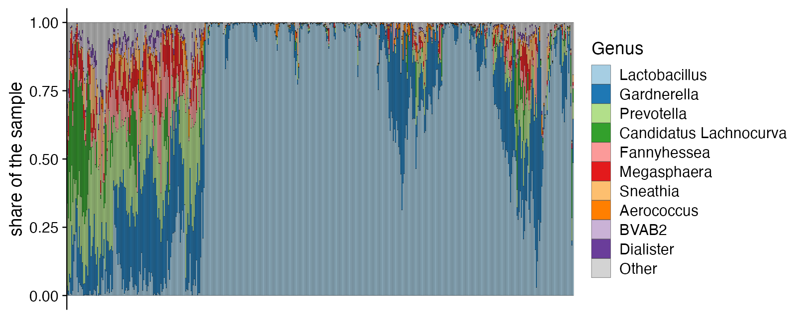
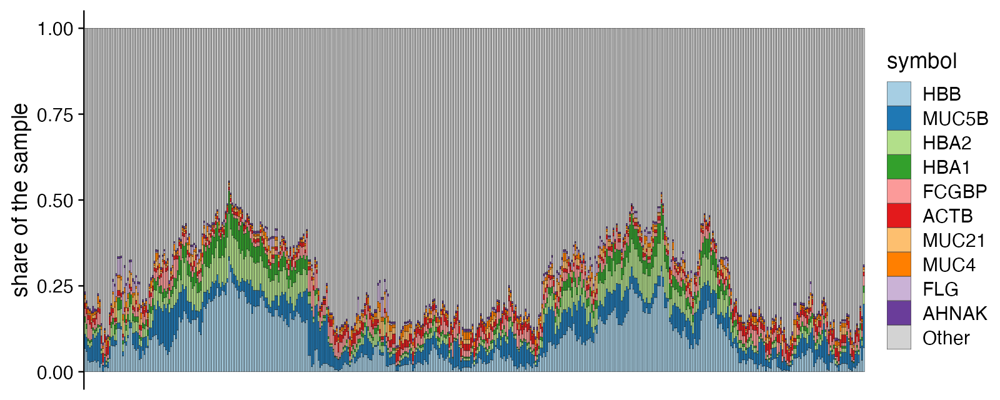
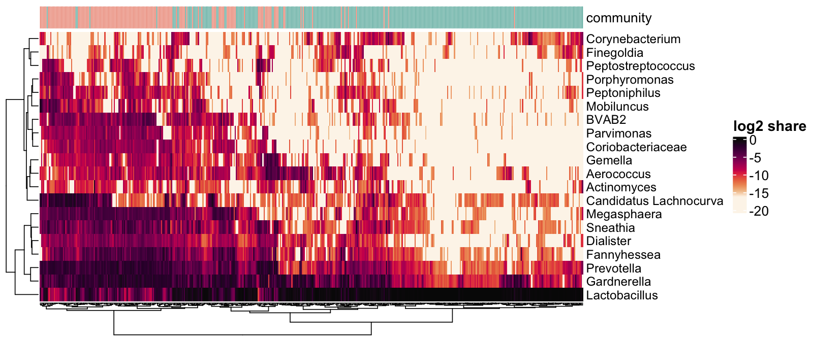
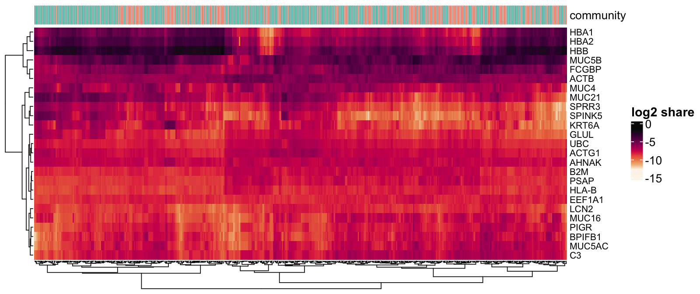
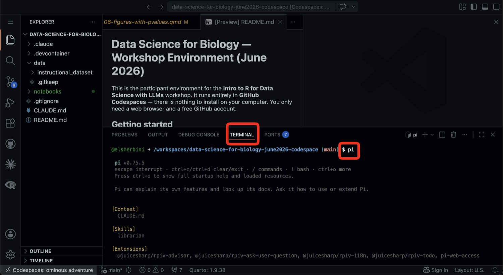

```{r setup, include=FALSE}
library(tidyverse)
library(patchwork)
library(knitr)
library(cowplot)
pal <- c(navy = "#2b3a67", teal = "#2a9d8f", orange = "#e76f51",
         gold = "#e9c46a", grey = "#bbbbbb")
tab_col <- c(species = pal[["teal"]], genes = pal[["orange"]])
theme_set(theme_cowplot(16))

res <- "results"
qc <- read_csv(file.path(res, "sample_qc.csv"), show_col_types = FALSE) |>
  mutate(table = factor(table, c("species", "genes")))
fc <- read_csv(file.path(res, "filter_curve.csv"), show_col_types = FALSE) |>
  mutate(table = factor(table, c("species", "genes")))
fs <- read_csv(file.path(res, "feature_summary.csv.gz"), show_col_types = FALSE) |>
  mutate(table = factor(table, c("species", "genes")),
         mean_cpm = mean_share * 1e6)   # mean of the per-sample proportions, x 1e6
qc <- qc |> mutate(effective = exp(shannon))
groups <- read_csv("../4-differential/results/sample_groups.csv", show_col_types = FALSE) |>
  select(sample_id, community)
species_qc <- qc |> filter(table == "species") |> inner_join(groups, by = "sample_id")
eff_by_comm <- species_qc |> group_by(community) |> summarise(m = median(effective)) |> deframe()
top10 <- read_csv(file.path(res, "top10_share.csv"), show_col_types = FALSE)
top10_of <- setNames(top10$median_share, top10$table)

# Monday's four pom-pom bags, copied from the "Fill the four bags" table in
# ../1-reads-to-counts/analog_activities.qmd. Keep the two in step.
ball_hex <- c(orange = "#E69F00", green = "#009E73", blue = "#0072B2", pink = "#CC79A7",
              red = "#CA0C0C", sky_blue = "#56B4E9", yellow = "#F0E442",
              grey = "#999999")
bags <- tribble(
  ~bag,    ~orange, ~green, ~blue, ~pink, ~red, ~sky_blue, ~yellow, ~grey,
  "bag 1",      42,      4,     1,     0,           1,         0,       1,     1,
  "bag 2",       4,     38,     4,     0,           1,         0,       1,     2,
  "bag 3",       1,      4,    35,     0,           4,         2,       2,     2,
  "bag 4",       0,      1,     9,    23,           5,         5,       5,     2
) |>
  pivot_longer(-bag, names_to = "colour", values_to = "n") |>
  group_by(bag) |>
  mutate(p = n / sum(n)) |>
  ungroup()
shannon_of <- function(p) { p <- p[p > 0]; -sum(p * log(p)) }
bag_summary <- bags |>
  group_by(bag) |>
  summarise(colours = sum(n > 0), top = max(p), shannon = shannon_of(p)) |>
  bind_rows(tibble(bag = c("one colour only", "8 colours, 6 of each"),
                   colours = c(1, 8), top = c(1, 1 / 8), shannon = c(0, log(8)))) |>
  mutate(effective = exp(shannon))
```

## {data-menu-title="Wi-Fi"}

\
\

### Wi-Fi {style="font-size: 2.5em; text-align: center"}

::: {style="font-size: 1.5em; text-align: center"}
Network: **Golden_Tulip**

Click on **Conference**

Password: **Diamond254**
:::

## Yesterday you built a count table out of pom-poms {.center}

Today the same table has 220 rows of bacteria, 14,226 rows of human genes, and
471 columns.

## Reading the files

```{r}
#| eval: false
library(tidyverse)
library(here)

data_dir <- "data/2-workshop2/instructional_dataset"

metadata <- read_csv(here(data_dir, "01_metadata.csv"))
species  <- read_csv(here(data_dir, "02_microbiome_counts.csv"))
genes    <- read_csv(here(data_dir, "04_rnaseq_counts.csv.gz"))
```

Three of the six files in the folder. Each one becomes a tibble.

## The six files {.smaller}

```{r}
#| echo: false
tibble(
  file = c("01_metadata.csv", "02_microbiome_counts.csv", "03_microbiome_taxonomy.csv",
           "04_rnaseq_counts.csv.gz", "05_gene_annotation.csv", "06_cytokines.csv"),
  `what it holds` = c("one row per sample: participant, visit, outcome, clinical measures",
                      "220 bacterial species x 471 samples",
                      "what each species is: domain down to species",
                      "14,226 human genes x 471 samples",
                      "what each gene is: Ensembl id, symbol, name",
                      "measured protein concentrations, for the group projects")
) |> kable()
```

## A corner of the species table

::: {style="font-size: 80%;"}
```{r}
#| echo: false
read_csv(file.path(res, "corner_species.csv"), show_col_types = FALSE) |>
  select(1:4) |>
  kable()
```
:::

6 of 220 rows and 3 of 471 columns: participant P001 at three visits.

## A corner of the gene table

::: {style="font-size: 80%;"}
```{r}
#| echo: false
read_csv(file.path(res, "corner_genes.csv"), show_col_types = FALSE) |>
  select(1:4) |>
  kable()
```
:::

The same three samples. Both tables have features in rows, samples in columns
and counts in the cells.

## One row per count

```{r}
#| eval: false
species_long <- species |>
  pivot_longer(-taxon,
               names_to = "sample_id", values_to = "count")
```

:::: {.columns}
::: {.column width="55%" style="font-size: 75%;"}
```{r}
#| echo: false
read_csv(file.path(res, "corner_species.csv"), show_col_types = FALSE) |>
  select(taxon = 1, 2:4) |>
  pivot_longer(-taxon, names_to = "sample_id", values_to = "count") |>
  head(6) |>
  kable()
```
:::
::: {.column width="45%"}
220 species times 471 samples gives 103,620 rows.

::: {.fragment}
In this shape, `group_by(sample_id)` works on one sample at a time and
`group_by(taxon)` works on one species at a time.
:::
:::
::::

## The questions we ask of both tables

::: {.incremental}
1. How deeply was each sample sequenced?
2. How many features did we see in each sample?
3. How evenly is each sample spread across its features?
4. Which features can we afford to keep?
:::

. . .

Answering them is the quality control step, and it is all we do today.

## 1. Sequencing depth

```{r}
#| echo: false
#| fig-width: 10
#| fig-height: 2.7
ggplot(qc, aes(library_size, fill = table)) +
  geom_histogram(bins = 45, colour = "white") +
  scale_x_log10(labels = scales::label_number(scale_cut = scales::cut_short_scale())) +
  scale_fill_manual(values = tab_col) +
  facet_wrap(~table, scales = "free") +
  labs(x = "total counts in the sample (log scale)", y = "samples") +
  theme(legend.position = "none")
```

:::: {.columns style="font-size: 80%;"}
::: {.column width="58%"}
```{r}
#| echo: false
qc |>
  group_by(table) |>
  summarise(median = scales::comma(median(library_size)),
            smallest = scales::comma(min(library_size)),
            largest = scales::comma(max(library_size))) |>
  kable(align = "lrrr")
```
:::
::: {.column width="42%"}
Both spread over more than an order of magnitude. Note the axis labels.

::: {.fragment}
One sample has 438 bacterial reads. What would you do with it?
:::
:::
::::

## 2. Features detected

```{r}
#| echo: false
#| fig-width: 10
#| fig-height: 3.0
rho <- qc |>
  group_by(table) |>
  summarise(rho = cor(library_size, features_detected, method = "spearman"),
            # extra features seen in the deepest fifth of samples vs the shallowest
            gain = median(features_detected[library_size >= quantile(library_size, 0.8)]) -
                   median(features_detected[library_size <= quantile(library_size, 0.2)]))
rho_of <- setNames(rho$rho, rho$table)
strip <- setNames(sprintf("%s, Spearman rho = %.2f", rho$table, rho$rho), rho$table)
qc |>
  ggplot(aes(library_size, features_detected, colour = table)) +
  geom_point(alpha = 0.5, size = 2) +
  scale_x_log10(labels = scales::label_number(scale_cut = scales::cut_short_scale())) +
  scale_colour_manual(values = tab_col) +
  facet_wrap(~table, scales = "free", labeller = as_labeller(strip)) +
  labs(x = "library size (log scale)", y = "features detected") +
  theme(legend.position = "none")

# species detected by community type, using the grouping built later today
richness <- qc |>
  filter(table == "species") |>
  inner_join(read_csv("../4-differential/results/sample_groups.csv", show_col_types = FALSE) |>
               select(sample_id, community), by = "sample_id") |>
  group_by(community) |>
  summarise(median_detected = median(features_detected))
rich_of <- setNames(richness$median_detected, richness$community)
```

Deeper gene libraries do detect more genes (rho = `r sprintf("%.2f", rho_of[["genes"]])`),
but only about `r round(rho$gain[rho$table == "genes"], -1)` more from the shallowest
fifth of samples to the deepest, out of 14,226.

. . .

In the species table depth barely matters at these depths
(rho = `r sprintf("%.2f", rho_of[["species"]])`). The community does:
samples dominated by *Lactobacillus* show a median of
`r rich_of[["lactobacillus"]]` species, and the rest show `r rich_of[["anaerobe"]]`.

## The same picture as a fraction

```{r}
#| echo: false
qc |>
  group_by(table) |>
  summarise(`features in the table` = scales::comma(first(features_total)),
            `median detected` = scales::comma(median(features_detected)),
            `median share detected` = scales::percent(median(features_detected / features_total), 0.1),
            `median cells that are zero` = scales::percent(median(zero_fraction), 0.1)) |>
  kable(align = "lrrrr")
```

. . .

The species table is mostly zeros and the gene table is almost solid, so the
two tables need different filters.

## 3. Dominance by one feature

```{r}
#| echo: false
#| fig-width: 10
#| fig-height: 3.6
ggplot(qc, aes(top_feature_share, fill = table)) +
  geom_histogram(bins = 40, colour = "white") +
  scale_x_continuous(labels = scales::percent) +
  scale_fill_manual(values = tab_col) +
  facet_wrap(~table, scales = "free") +
  labs(x = "share of the sample held by its single largest feature", y = "samples") +
  theme(legend.position = "none")
```

Half of our bacterial samples are more than 60% one species. The most extreme
is 99.9%.

## Same number of colours, different diversity

```{r}
#| echo: false
#| fig-width: 10
#| fig-height: 2.5
bags |>
  filter(bag %in% c("bag 1", "bag 4"), n > 0) |>
  left_join(bag_summary |> select(bag, colours), by = "bag") |>
  mutate(label = sprintf("%s: %d colours", bag, colours),
         colour = factor(colour, rev(names(ball_hex)))) |>
  ggplot(aes(p, fct_rev(label), fill = colour)) +
  geom_col(colour = "white", width = 0.7) +
  scale_fill_manual(values = ball_hex, guide = "none") +
  scale_x_continuous(labels = scales::percent) +
  labs(x = "share of the bag", y = NULL) +
  theme(panel.grid = element_blank(), axis.text.y = element_text(size = 16))
```

Which bag is more diverse? Counting colours says they are nearly the same.

::: {.notes}
Demo with Monday's bags 1 and 4. Ask the room which is more diverse, then count
the colours together: 6 against 7.

Then the guessing game. A volunteer names the colour before each draw, five
draws from each bag. From bag 1 they are right almost every time. From bag 4
they keep being surprised. That surprise is what the next slide measures.

If you have spare pom-poms, pour a bag of one colour and a bag of eight colours,
six of each, to show the two ends of the scale: 0 and 2.08.
:::

## Shannon diversity is the average surprise

:::: {.columns}
::: {.column width="48%"}
Draw one ball. If its colour makes up a share *p* of the bag, your surprise is
−ln(*p*).

::: {.incremental}
- an orange from bag 1, 84% of it: `r round(-log(42/50), 2)`
- a blue from bag 1, 2% of it: `r round(-log(1/50), 2)`
- Shannon is the average over many draws: −Σ *p* ln(*p*)
- Rare colours surprise you a lot, but you rarely draw them, so they add little.
:::
:::
::: {.column width="52%" style="font-size: 0.8em;"}
::: {.fragment}
```{r}
#| echo: false
bag_summary |>
  transmute(bag, colours, `top colour` = scales::percent(top, 1),
            Shannon = sprintf("%.2f", shannon)) |>
  kable(align = "lrrr")
```
:::
:::
::::

## The effective number of species

exp(Shannon) is **how many equally common colours** would give the same
Shannon value.

```{r}
#| echo: false
bag_summary |>
  transmute(bag, colours, `effective number` = sprintf("%.1f", effective)) |>
  kable(align = "lrr")
```

. . .

Bag 1 has six colours but behaves like two. Bag 4 behaves like five.

## Computing it for every sample

```{r}
#| eval: false
species_long |>
  group_by(sample_id) |>
  mutate(p = count / sum(count)) |>
  filter(p > 0) |>
  summarise(shannon   = -sum(p * log(p)),
            effective = exp(shannon))
```

. . .

`log()` in R is the natural log, and `exp()` undoes it.

. . .

Start from `genes_long` and the same six lines give the numbers for the gene
table.

## Our two tables, as effective numbers

```{r}
#| echo: false
#| fig-width: 10
#| fig-height: 3.3
ggplot(qc, aes(effective, fill = table)) +
  geom_histogram(bins = 40, colour = "white") +
  scale_x_log10(labels = scales::label_comma()) +
  scale_fill_manual(values = tab_col) +
  facet_wrap(~table, scales = "free") +
  labs(x = "effective number of features (log scale)", y = "samples") +
  theme(legend.position = "none")
```

The median vaginal sample behaves like
`r round(median(qc$effective[qc$table == "species"]))` equally common species.
The median transcriptome behaves like about
`r scales::comma(signif(median(qc$effective[qc$table == "genes"]), 2))` equally
expressed genes.

## In the vagina, low diversity is the healthy state

```{r}
#| echo: false
#| fig-width: 10
#| fig-height: 3.1
species_qc |>
  ggplot(aes(effective, community, colour = community)) +
  geom_boxplot(outlier.shape = NA, width = 0.5) +
  geom_jitter(height = 0.15, alpha = 0.4, size = 1.5) +
  scale_x_log10() +
  scale_colour_manual(values = c(lactobacillus = pal[["teal"]], anaerobe = pal[["orange"]]),
                      guide = "none") +
  labs(x = "effective number of species (log scale)", y = NULL)
```

Samples dominated by *Lactobacillus* behave like about
`r round(eff_by_comm[["lactobacillus"]])` species. The rest behave like about
`r round(eff_by_comm[["anaerobe"]])`.
In the gut, more diverse usually reads as healthier. Here it is the reverse.

## What Shannon diversity tracks in our tables

```{r}
#| echo: false
qc |>
  group_by(table) |>
  summarise(`library size` = cor(shannon, library_size, method = "spearman"),
            `features detected` = cor(shannon, features_detected, method = "spearman"),
            `top feature's share` = cor(shannon, top_feature_share, method = "spearman")) |>
  pivot_longer(-table, names_to = "Shannon against", values_to = "rho") |>
  pivot_wider(names_from = table, values_from = rho) |>
  mutate(across(c(species, genes), ~ sprintf("%.2f", .x))) |>
  kable(align = "lrr", caption = "Spearman correlations")
```

. . .

Depth barely moves it, because depth mostly changes how many rare features you
catch, and rare features add little. In both tables it is close to the mirror
image of dominance, the share held by the top feature.

## Shannon diversity of a transcriptome {.center}

Nobody reports the Shannon diversity of a transcriptome, even though "behaves
like about a thousand equally expressed genes" is a fair summary of one.

. . .

Still, the number of features you detected and how evenly the counts are
spread are what you look at to decide **which samples to throw away**, in
both experiments.

. . .

Microbiome papers report these numbers as alpha diversity. RNA-seq papers
bury them in the QC section.

## 4. Filtering features

```{r}
#| eval: false
# keep a species if it appears in at least 10% of samples
species_kept <- species_long |>
  group_by(taxon) |>
  filter(mean(count > 0) >= 0.10) |>
  ungroup()
```

```{r}
#| echo: false
#| fig-width: 10
#| fig-height: 3.1
fc |>
  pivot_longer(c(features_kept, share_of_counts_kept)) |>
  mutate(name = recode(name, features_kept = "features kept",
                       share_of_counts_kept = "share of all counts kept")) |>
  ggplot(aes(min_prevalence, value, colour = table)) +
  geom_line(linewidth = 1.3) +
  scale_colour_manual(values = tab_col) +
  scale_x_continuous(labels = scales::percent) +
  facet_wrap(vars(name, table), nrow = 2, scales = "free_y",
             labeller = labeller(.multi_line = FALSE)) +
  expand_limits(y = 0) +
  labs(x = "minimum prevalence required to keep a feature", y = NULL, colour = NULL) +
  theme(legend.position = "none")
```

## The filter curve at four cutoffs

```{r}
#| echo: false
fc |>
  filter(min_prevalence %in% c(0, 0.10, 0.25, 0.50)) |>
  transmute(table, `prevalence cutoff` = scales::percent(min_prevalence),
            `features kept` = scales::comma(features_kept),
            `counts kept` = scales::percent(share_of_counts_kept, 0.01)) |>
  pivot_wider(names_from = table, values_from = c(`features kept`, `counts kept`),
              names_glue = "{table}: {.value}") |>
  select(1, 2, 4, 3, 5) |>
  kable(align = "lrrrr")
```

::: {.incremental}
- Species: a 10% prevalence filter drops **161 of 220** features and loses
  **0.8%** of the data.
- Genes: the same filter drops **nothing**, so prevalence is the wrong thing to
  filter on.
:::

## A different filter for each table {.smaller}

| | sparse table (species) | dense table (genes) |
|---|---|---|
| the problem | most features are absent from most samples | nearly everything is present at some level |
| filter on | prevalence | expression level |
| typical rule | present in at least 10% of samples | mean CPM of at least 5 |
| what it buys you | fewer tests, less noise | fewer tests, less noise |

: {tbl-colwidths="[22,39,39]"}

```{r}
#| echo: false
#| fig-width: 10
#| fig-height: 2.5
p_prev <- fs |>
  filter(table == "species") |>
  ggplot(aes(prevalence)) +
  geom_histogram(binwidth = 0.025, boundary = 0, fill = tab_col[["species"]], colour = "white") +
  geom_vline(xintercept = 0.10, linetype = "dashed", colour = pal[["navy"]]) +
  scale_x_continuous(labels = scales::percent) +
  labs(title = "species: prevalence, cutoff at 10%",
       x = "share of samples where the species is seen", y = "species")
p_cpm <- fs |>
  filter(table == "genes") |>
  ggplot(aes(mean_cpm)) +
  geom_histogram(bins = 50, fill = tab_col[["genes"]], colour = "white") +
  geom_vline(xintercept = 5, linetype = "dashed", colour = pal[["navy"]]) +
  scale_x_log10(labels = scales::label_comma(drop0trailing = TRUE)) +
  labs(title = "genes: mean CPM, cutoff at 5",
       x = "mean counts per million (log scale)", y = "genes")
p_prev + p_cpm
```

## You cannot compare raw counts

```{r}
#| eval: false
species_long |>
  group_by(sample_id) |>
  mutate(proportion = count / sum(count),
         cpm        = proportion * 1e6) |>
  ungroup()
```

```{r}
#| echo: false
#| fig-width: 10
#| fig-height: 2.2
toy <- tibble(
  sample = rep(c("sample 1, 1,000 reads", "sample 2, 2,000 reads"), each = 3),
  feature = rep(c("feature A", "feature B", "feature C"), 2),
  count = c(600, 300, 100, 1200, 600, 200)
) |>
  group_by(sample) |>
  mutate(proportion = count / sum(count)) |>
  ungroup()
p_raw <- ggplot(toy, aes(feature, count, fill = sample)) +
  geom_col(position = "dodge", width = 0.7) +
  scale_fill_manual(values = unname(pal[c("navy", "gold")])) +
  labs(title = "raw counts (toy data)", x = NULL, y = NULL, fill = NULL)
p_prop <- ggplot(toy, aes(feature, proportion, fill = sample)) +
  geom_col(position = "dodge", width = 0.7) +
  scale_fill_manual(values = unname(pal[c("navy", "gold")])) +
  scale_y_continuous(labels = scales::percent) +
  labs(title = "after dividing by the column total", x = NULL, y = NULL, fill = NULL)
p_raw + p_prop + plot_layout(guides = "collect") &
  theme(legend.position = "bottom")
```

. . .

Microbiome papers call this "relative abundance". RNA-seq papers call it "CPM".

## And then you take a log

```{r}
#| echo: false
#| fig-width: 10
#| fig-height: 3.3
set.seed(4)
x <- rnbinom(4000, mu = 40, size = 0.35)
p1 <- tibble(x) |> ggplot(aes(x)) +
  geom_histogram(bins = 50, fill = pal[["navy"]], colour = "white") +
  labs(title = "counts per million", x = NULL, y = NULL)
p2 <- tibble(x) |> ggplot(aes(log2(x + 1))) +
  geom_histogram(bins = 50, fill = pal[["navy"]], colour = "white") +
  labs(title = "log2(counts per million + 1)", x = NULL, y = NULL)
p1 + p2
```

The `+ 1` is there because `log2(0)` is negative infinity. That choice changes
your answer, and you should be able to say why you made it.

## One helper for both tables {.smaller}

`as_counts()` builds the same kind of object from either table, and we use it
all week.

```{r}
#| eval: false
library(microViz)
source("R/count_tables.R")

species_ps <- as_counts(table = "microbiome")
genes_ps   <- as_counts(table = "rnaseq")
```

. . .

microViz was written for microbiome data. It wants a count table, a sample
table, and a table saying what each feature *is*. A gene annotation fills that
third slot, so the same verbs work on genes.

| microViz wants | species | genes |
|---|---|---|
| counts | `02_microbiome_counts.csv` | `04_rnaseq_counts.csv.gz` |
| samples | `01_metadata.csv` | `01_metadata.csv` |
| what each feature is | `03_microbiome_taxonomy.csv`: Domain down to species | `05_gene_annotation.csv`: `locus_group`, then `symbol` |

: {tbl-colwidths="[24,38,38]"}

## The same call, twice

```{r}
#| eval: false
species_ps |>
  comp_barplot(tax_level = "Genus", n_taxa = 10)

genes_ps |>
  comp_barplot(tax_level = "symbol", n_taxa = 10)
```

. . .

The first is the stacked bar chart from almost every microbiome paper you have
read.

. . .

Nobody makes the second. The next two slides show why.

## Ten genera fill the bar

{width=100% fig-alt="Stacked bar chart of the ten most abundant genera in 471 samples. Lactobacillus fills most bars and the grey Other block is barely visible."}

In a typical sample the ten largest genera hold
`r scales::percent(top10_of[["species"]], 1)` of the reads.

## Ten genes leave most of the bar grey

{width=100% fig-alt="Stacked bar chart of the ten most abundant genes in 471 samples. The grey Other block takes up most of every bar."}

In a typical sample the ten largest genes hold
`r scales::percent(top10_of[["genes"]], 1)` of the reads. The grey block is the
other 14,216 genes.

## A heatmap gives each feature its own row

A stacked bar has to share one axis between all the features, so anything
below a few percent disappears.

. . .

In a heatmap each feature gets a row and each sample a column. The colour of a
cell is that feature's share of that sample, on a log scale.

. . .

```{r}
#| eval: false
species_log <- species_ps |>
  tax_transform("compositional", rank = "Genus") |>
  tax_transform("log2", zero_replace = "halfmin",
                chain = TRUE)

species_log |>
  comp_heatmap(taxa = tax_top(species_log, n = 20))
```

::: {.notes}
"compositional" is the division by the sample total from three slides back, and
"log2" is the log. `zero_replace = "halfmin"` is this function's answer to
log2(0): zeros become half the smallest value above zero. It does the same job
as the + 1.
:::

## Twenty genera in 471 samples

{width=100% fig-alt="Heatmap of the 20 most abundant genera across 471 samples, with a strip on top coloured by community group."}

::: {style="font-size: 80%;"}
Darker cells are larger shares. `comp_heatmap()` puts similar samples next to
each other. The strip on top is the grouping column you build in Exercise 2.
:::

## The same heatmap for genes

```{r}
#| eval: false
genes_log <- genes_ps |>
  tax_transform("compositional", rank = "symbol") |>
  tax_transform("log2", zero_replace = "halfmin",
                chain = TRUE)

genes_log |>
  comp_heatmap(taxa = tax_top(genes_log, n = 25))
```

. . .

The code changes in two places: the rank is `"symbol"`, and we ask for 25
rows.

## Twenty-five genes in 471 samples

{width=100% fig-alt="Heatmap of the 25 most abundant genes across 471 samples, with a strip on top coloured by community group."}

::: {style="font-size: 80%;"}
HBA1, HBA2 and HBB are haemoglobin, and they rise and fall together. What does
a sample that is dark in those three rows have in it?
:::

## Bar chart or heatmap?

| | stacked bar chart | heatmap |
|---|---|---|
| shows | shares that add up to the whole sample | each feature on its own row |
| scale | linear | log |
| suits | a few features that hold most of the counts | many features, large and small |
| species table | yes | yes |
| gene table | no | yes |

: {tbl-colwidths="[20,40,40]"}

## Where you write code this week

:::: {.columns}
::: {.column width="38%"}
A **Codespace** is a computer that GitHub runs for you. R, Quarto, the
packages and the data are already on it.

**VS Code** is the editor you see in the browser tab. Your files are on the
left, the open notebook is in the middle, and the terminal is at the bottom.

Nothing is installed on your laptop.
:::
::: {.column width="62%"}
{width=100% fig-alt="A Codespace in the browser: file explorer on the left, a document in the middle, and a terminal at the bottom with Pi starting."}
:::
::::

## A chat window and an agent

```{r}
#| echo: false
#| fig-width: 10
#| fig-height: 3.5
boxes <- tribble(
  ~panel,  ~x,  ~y,  ~label,                       ~fill,
  "chat",  1,   2,   "you",                        pal[["navy"]],
  "chat",  0,   0.4, "chat window",                pal[["grey"]],
  "chat",  2,   0.4, "R on your\ncomputer",        pal[["teal"]],
  "agent", 1,   2,   "you",                        pal[["navy"]],
  "agent", 0,   0.4, "agent",                      pal[["orange"]],
  "agent", 2,   0.4, "files and R in\nyour Codespace", pal[["teal"]]
) |>
  mutate(panel = factor(panel, c("chat", "agent"),
                        c("chat: you carry the code", "agent: it runs the code itself")))
arrows <- tribble(
  ~panel,  ~x,   ~y,   ~xend, ~yend, ~label,                ~lx,   ~ly,
  "chat",  0.75, 1.65, 0.2,   0.8,   "question,\nerror",    0.02,  1.3,
  "chat",  0.4,  0.8,  0.95,  1.65,  "",                    NA,    NA,
  "chat",  1.25, 1.65, 1.8,   0.8,   "paste code,\nrun it", 1.98,  1.3,
  "chat",  1.6,  0.8,  1.05,  1.65,  "",                    NA,    NA,
  "agent", 0.75, 1.65, 0.2,   0.8,   "one request",         0.05,  1.3,
  "agent", 0.4,  0.8,  0.95,  1.65,  "",                    NA,    NA,
  "agent", 0.55, 0.52, 1.45,  0.52,  "read, write, run",    1,     0.78,
  "agent", 1.45, 0.28, 0.55,  0.28,  "output, errors",      1,     0.04
) |>
  mutate(panel = factor(panel, c("chat", "agent"), levels(boxes$panel)))
ggplot() +
  geom_segment(data = arrows, aes(x, y, xend = xend, yend = yend),
               colour = "grey35", linewidth = 0.9,
               arrow = arrow(length = unit(0.22, "cm"), type = "closed")) +
  geom_label(data = boxes, aes(x, y, label = label, fill = I(fill)), colour = "white",
             fontface = "bold", size = 5.5, lineheight = 0.9,
             label.padding = unit(0.6, "lines"), label.size = 0) +
  geom_text(data = arrows |> filter(!is.na(lx)), aes(lx, ly, label = label),
            size = 4.6, colour = "grey25", lineheight = 0.9) +
  facet_wrap(~panel) +
  scale_x_continuous(limits = c(-0.6, 2.6)) +
  scale_y_continuous(limits = c(-0.15, 2.3)) +
  theme_void(base_size = 16) +
  theme(strip.text = element_text(face = "bold", size = 17, margin = margin(b = 8)),
        panel.spacing = unit(2, "lines"))
```

With a chat window you copy code into R, run it, and copy the error back. An
agent has tools for those steps and repeats them until it thinks the task is
done.

## One request, many steps

You type: *plot the library size of every sample in the species table*

::: {.incremental}
1. Pi reads `notebooks/02-count-table-anatomy.qmd`
2. It reads the first lines of `02_microbiome_counts.csv`
3. It writes a chunk that reshapes the table and draws a histogram
4. It runs the chunk and gets an error about a column name
5. It fixes the chunk and runs it again
6. It tells you what it did
:::

. . .

Pi does not stop to ask you between steps. Read the code from step 5 before
you believe the summary in step 6.

## Pi works from what is in your folder

Before it answers, Pi reads `CLAUDE.md` at the top of your repository. Ours
says you are a biologist who is new to coding.

. . .

After that it knows only the files it opens and the conversation so far.

::: {.incremental}
- An old notebook with a different filter looks as valid to Pi as today's.
- Two csv files with similar names get mixed up.
- A long conversation about one question bends its answers to the next.
:::

. . .

Type `/new` to start a fresh conversation when you change task.

## Pi, Claude Code and Codex

All three are coding agents that run in a terminal and work in the same loop.

::: {style="font-size: 75%;"}
| | Pi | Claude Code | Codex |
|---|---|---|---|
| made by | an open-source project | Anthropic | OpenAI |
| models | from any provider | built for Claude | built for GPT |
| you pay through | our OpenRouter key, per request | an Anthropic plan or API key | an OpenAI plan or API key |
| before running a command | does not ask | asks, unless you change it | asks, unless you change it |

: {tbl-colwidths="[22,26,26,26]"}
:::

. . .

We chose Pi because one key reaches models from many companies, so you can
change model with one command and see what each costs. What you practise with
Pi carries over to the other two.

## Models cost different amounts

Your key has a **\$3 daily limit**. Every request spends some of it.

::: {.incremental}
- Pi starts on `z-ai/glm-5.3-flash`, which is cheap and fast.
- `/model` or `Ctrl+L` switches to `z-ai/glm-5.3`, the larger model from the
  same family. It costs more per request.
- Start on the cheap one. Switch when it gets stuck, and switch back after.
:::

. . .

A long conversation costs more per message than a short one, because the whole
conversation is sent with every request.

## Pi in a Codespace {.our-turn}

Open your Codespace, open a terminal, type `pi` and press Enter.

Follow along while we give Pi its first task.

::: {.notes}
About ten minutes, driving a real Codespace on the projector.

1. Show the three panes: files, notebook, terminal. Start `pi`. Point at the
   [Context] line that lists CLAUDE.md.
2. Ask: "What is in data/2-workshop2/instructional_dataset? Do not run any
   analysis yet." Let the room watch it list and read files.
3. Ask: "In notebooks/02-count-table-anatomy.qmd, add a chunk that plots the
   library size of every sample in the species table." Narrate each tool call
   as it happens: read, edit, run.
4. Open the notebook and read the chunk aloud. Check one library size by hand
   with `sum(species$P001_week_18)`.
5. Show `/model`, switch to z-ai/glm-5.3 and back. Show `/new`.
:::

## Plan for the next ninety minutes

::: {.incremental}
1. Load both tables and check their shape against the metadata
2. Compute library size, features detected and dominance for both
3. Decide which samples and features to drop, and write down why
4. Build the one column the rest of the week depends on
5. Draw both tables with microViz, as bar charts and as heatmaps
:::

. . .

Do not skip step 4. This afternoon you colour your ordinations by that column,
and Wednesday afternoon starts from it.

## Your turn {.your-turn}

Open `notebooks/02-count-table-anatomy.qmd` in your Codespace.

```{r}
#| echo: false
countdown::countdown(45, left = 0, right = NULL, play_sound = TRUE)
```
