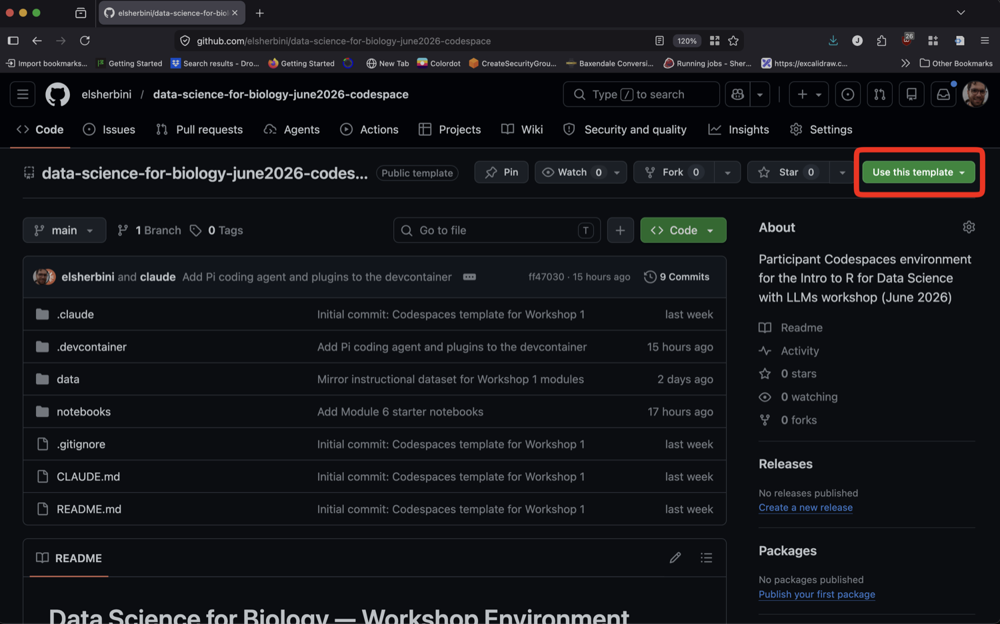
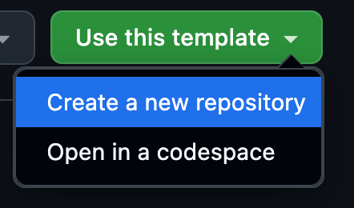
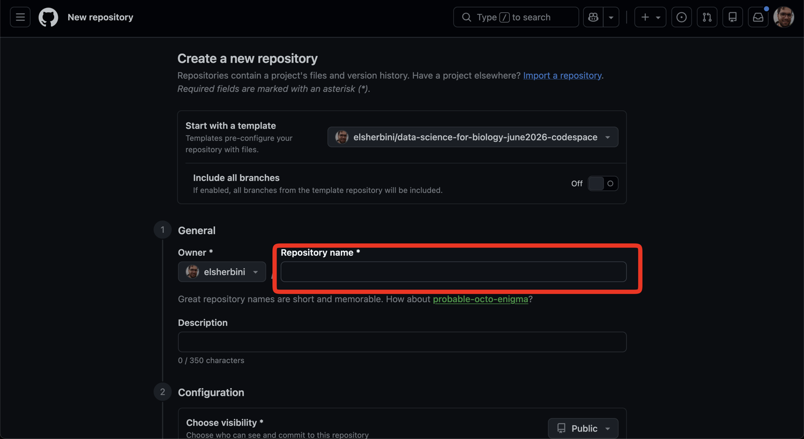
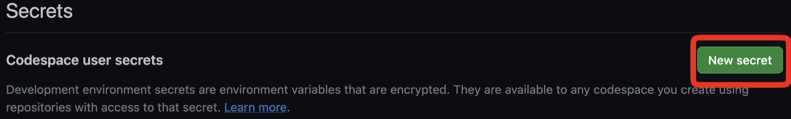
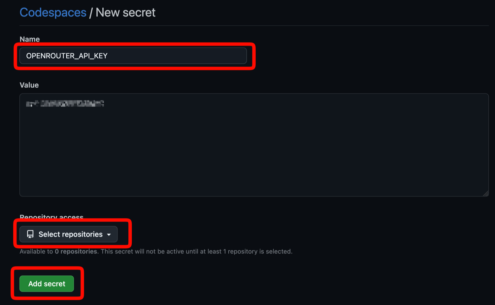
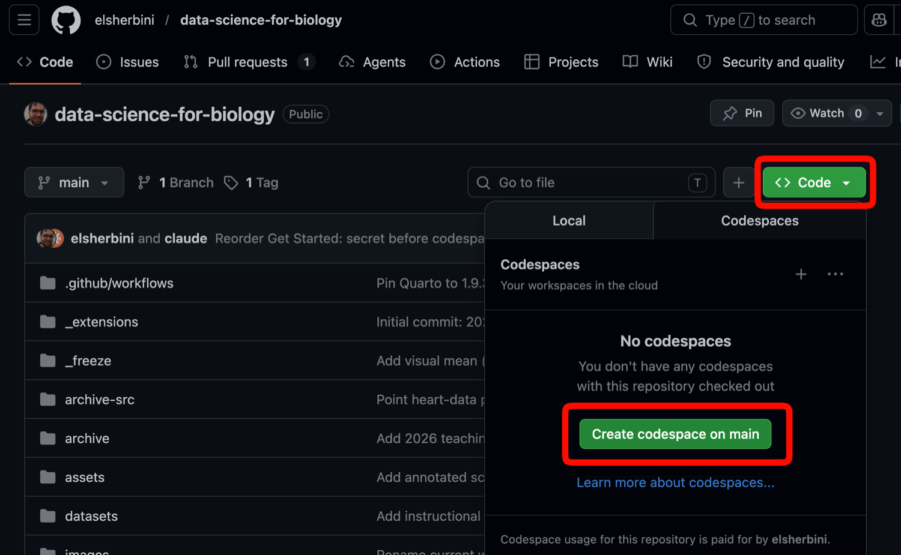
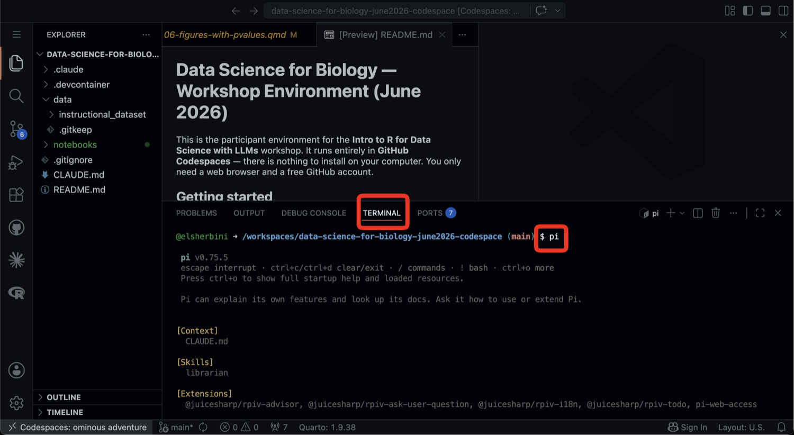

## The plan

**Before you arrive:** a GitHub account, a Discord account, and VS Code.

**Before Tuesday morning:** your own copy of the workshop repository, your API key added to GitHub, and your codespace built once.

**During the workshop, together:** Pi.

# Before you arrive

## Step 1: Create a GitHub account

Go to [github.com/signup](https://github.com/signup) and create a free account, or [sign in](https://github.com/login) if you already have one.

Pick a username you're happy for colleagues to see. You'll sign in every day.

## Step 2: Create a Discord account

Go to [discord.com/register](https://discord.com/register). The desktop app, phone app or browser all work.

Then open the [workshop Discord invite](https://discord.gg/9a9WcAUMR) and accept it.

Once you've joined, go to the [workshop channel](https://discord.com/channels/1567172556065079337/1567172557340278806).

## Step 3: Install VS Code

Download it from [code.visualstudio.com/download](https://code.visualstudio.com/download) and install with the default settings.

No setup or extensions needed. We'll do that together.

# Before Tuesday morning

Do these in order: the key goes into GitHub **before** you launch the codespace.

## Step 4: Open the template

**Sign in to GitHub first**, or the buttons won't appear.

Open the [workshop 2 participant repository](https://github.com/elsherbini/data-science-for-biology-nov2026-codespace) and click **"Use this template"**.

{width=900 fig-align="center" fig-alt="GitHub repo page with the 'Use this template' button highlighted"}

## Step 5: Create a new repository

In the dropdown, choose **"Create a new repository"**.

{width=400 fig-align="center" fig-alt="Use this template dropdown with 'Create a new repository' highlighted"}

## Step 6: Name your repository

Give it a name (for example, `multiomics-2026`) and click **"Create repository"**.

Don't launch a codespace yet. Get your key first.

{width=900 fig-align="center" fig-alt="New repository form with the Repository name field highlighted"}

## Step 7: Claim your key with `/claim`

Ask a TA or instructor for the **Participant** role.

Then type `/claim` in any channel. The reply is visible only to you and contains your API key. **Copy it.**

Later: `/key` shows it again, `/usage` shows today's spend.

## Step 8: Open Codespaces settings

Go to your [Codespaces settings page](https://github.com/settings/codespaces), scroll to **"Codespace user secrets"** and click **"New secret"**.

{width=1200 fig-align="center" fig-alt="Codespace user secrets section with the New secret button highlighted"}

## Step 9: Save the secret

- **Name**: `OPENROUTER_API_KEY` (exactly this)
- **Value**: paste your key
- **Repository access**: select the repo from step 6
- Click **"Add secret"**

{width=750 fig-align="center" fig-alt="New secret form with Name, Repository access, and Add secret highlighted"}

## Came to the June workshop?

You already have an `OPENROUTER_API_KEY` secret. **Don't make a new one**: GitHub won't allow two with the same name.

On your [Codespaces settings page](https://github.com/settings/codespaces), click **"Update"** next to `OPENROUTER_API_KEY`:

- Replace the value with your new key from Discord
- Under **Repository access**, add the repo from step 6
- Click **"Save changes"**

## Step 10: Launch a codespace

On your new repo: **"Code"** → **"Codespaces"** tab → **"Create codespace on main"**.

The first build takes **10 minutes or more**. Let it finish.

{width=800 fig-align="center" fig-alt="Repository page with the Code button and Create codespace on main button highlighted in the Codespaces tab"}

## Step 11: Check that R works

1. **Terminal → New Terminal**
2. Type `R`, press Enter
3. Type `library(tidyverse)`, press Enter

A list of packages and no `Error` means you're set. Type `q("no")` to leave R.

# During the workshop

## Step 12: Meet Pi

**Terminal → New Terminal**, then run `pi`.

Ask in plain language. Pi can read your notebook, explain code and help you edit.

{width=800 fig-align="center" fig-alt="Codespace with the integrated terminal open and the pi command typed at the prompt"}

## Pi can't find your key?

The codespace was probably launched before the key was added. Check the secret's name and repository access, then restart:

1. Go to [github.com/codespaces](https://github.com/codespaces)
2. **⋯** next to your codespace → **"Stop codespace"**
3. Click its name to open it again

## You're ready

If you get stuck, ask an instructor or a teaching assistant.
