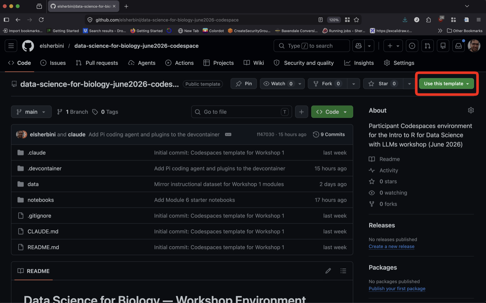
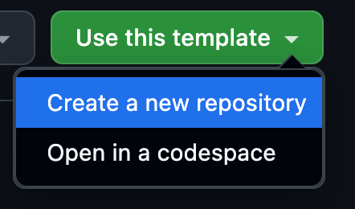
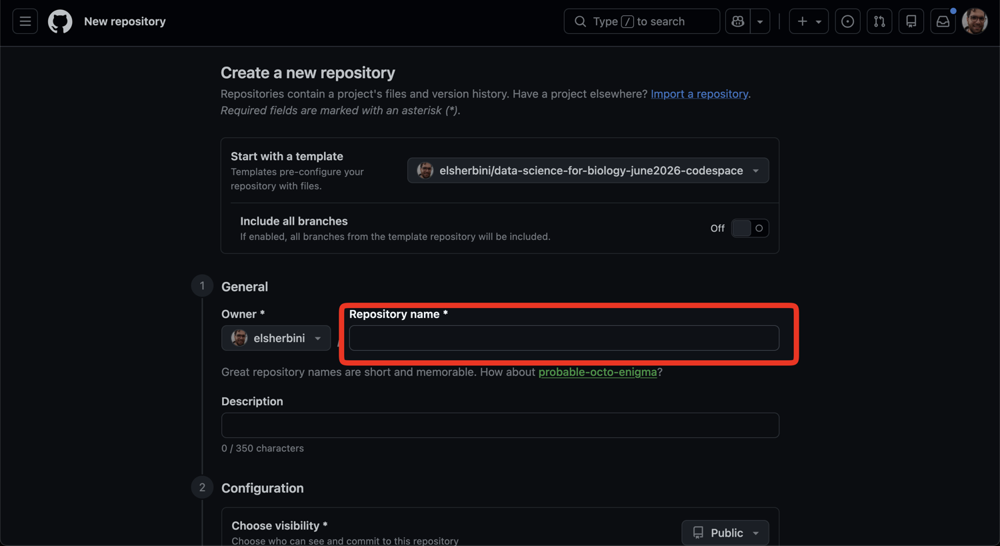
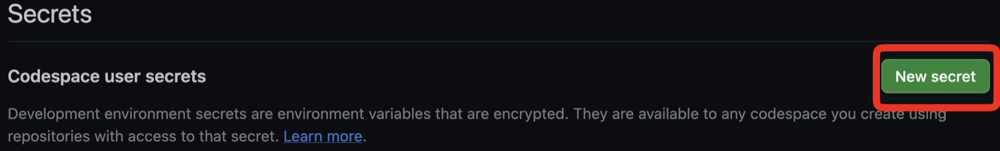
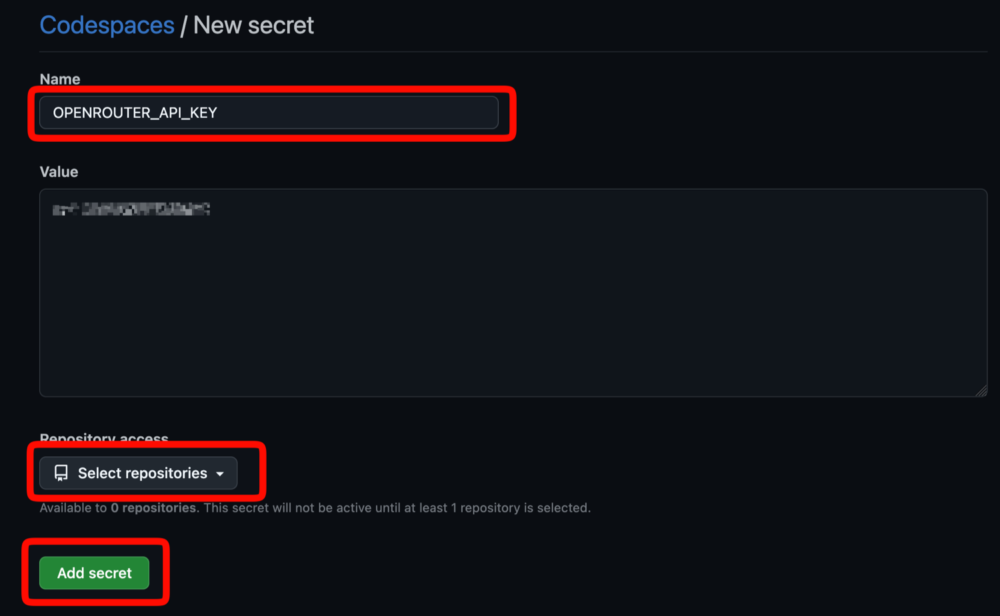
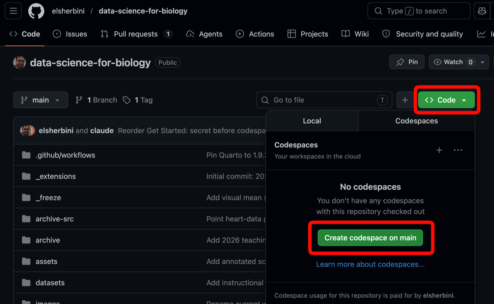
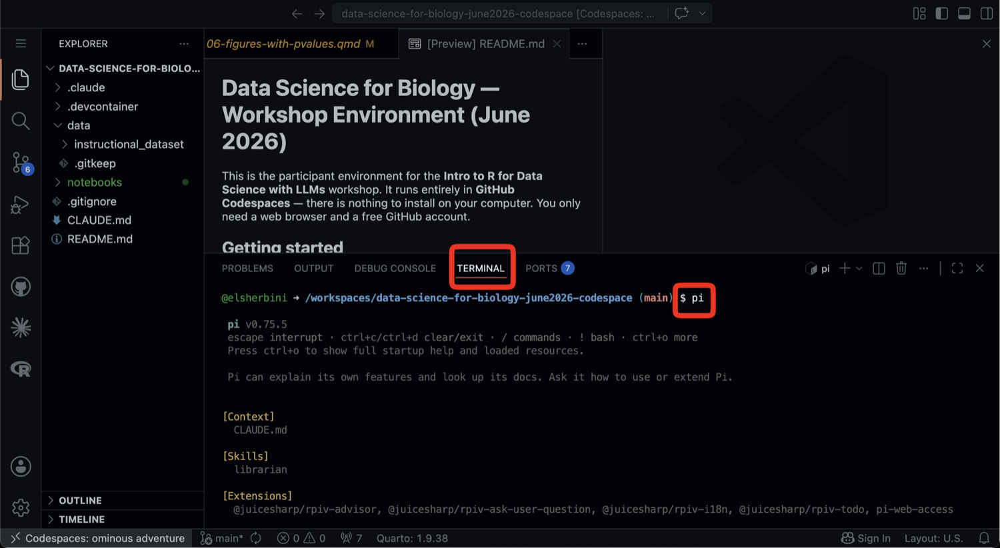

The workshop runs in the cloud using **GitHub Codespaces**. Your R, Quarto,
packages, data and AI coding agent all live there, so all you need on your
laptop is a web browser, VS Code, and two free accounts.

The setup comes in three parts:

**Before you arrive** (about 15 minutes)

1. [Create a GitHub account](#sec-github)
2. [Create a Discord account and join the workshop server](#sec-discord)
3. [Install VS Code](#sec-vscode)

**Before Tuesday morning** (Monday is fine, and teaching assistants can help)

4. [Make your own copy of the workshop repository](#sec-repo)
5. [Claim your API key in Discord](#sec-claim)
6. [Add the key to your GitHub account](#sec-secret)
7. [Launch your codespace and check that R works](#sec-launch)

**During the workshop** (we do this together)

8. [Meet Pi](#sec-pi)

## Instructions in slide form (long form below)
[Make slides full screen](getting-started-slides.qmd)

```{=html}
<iframe class="slide-deck" src="getting-started-slides.html" height="420" width="747" style="border: 1px solid #2e3846;"></iframe>
```

# Before you arrive

## 1. Create a GitHub account {#sec-github}

Go to [github.com/signup](https://github.com/signup) and create a free
account. If you already have one, just make sure you can
[sign in](https://github.com/login).

Choose a username you're happy for colleagues to see, and keep a note of your
password. You will sign in to GitHub every day of the workshop.

## 2. Create a Discord account and join the server {#sec-discord}

Go to [discord.com/register](https://discord.com/register) and create a free
account. You can use the desktop app, the phone app, or the browser.

Then open the [workshop Discord invite](https://discord.gg/9a9WcAUMR) and
accept it. This is where we post announcements, answer questions during the
week, and give you your API key for the coding agent.

Once you've joined, the
[workshop channel](https://discord.com/channels/1567172556065079337/1567172557340278806) is where
most of the conversation happens.

## 3. Install VS Code {#sec-vscode}

Download Visual Studio Code from
[code.visualstudio.com/download](https://code.visualstudio.com/download).
Choose the version for your laptop (Windows, Mac or Linux) and install it with
the default settings.

You don't need to set anything up or install any extensions. We'll do that
together.

# Before Tuesday morning

Do these four steps in order. Your codespace reads the API key when it is
first built, so the key has to be in GitHub before you launch the codespace.

## 4. Make your own copy of the workshop repository {#sec-repo}

The workshop environment lives in a **template** repository on GitHub. You'll
make your own copy of it.

::: {.callout-important}
Sign in to GitHub first. GitHub hides the **"Use this template"** and **"Code"**
buttons from visitors who aren't signed in, so the buttons below won't appear.
:::

### Open the template

Open the [workshop 2 participant repository](https://github.com/elsherbini/data-science-for-biology-nov2026-codespace) and click the
green **"Use this template"** button near the top right.

{.img-fluid fig-alt="GitHub repo page with the 'Use this template' button highlighted in the top right"}

### Create a new repository

In the dropdown, choose **"Create a new repository"**.

{.img-fluid fig-alt="Use this template dropdown with 'Create a new repository' highlighted"}

### Name it

Give the repository a name (for example, `multiomics-2026`) and click the green
**"Create repository"** button at the bottom of the form. Leave the owner as
your username.

{.img-fluid fig-alt="New repository form with the Repository name field highlighted"}

Don't launch a codespace yet. Get your key first.

## 5. Claim your API key in Discord {#sec-claim}

The coding agent needs an OpenRouter API key, and a bot in the workshop Discord
hands them out.

1. Ask a teaching assistant or an instructor to give you the **Participant**
   role. The bot only gives keys to people who have it.
2. In any channel, type `/claim` and press Enter. The bot's reply is visible
   only to you. It contains your personal API key and your daily budget.
3. **Copy the key.** You'll paste it into GitHub in the next step.

Two other commands you may want later:

- `/key` shows your key again if you lose track of it
- `/usage` shows how much of today's budget you've used (it resets at midnight
  UTC)

## 6. Add the key to your GitHub account {#sec-secret}

You store the key as a **Codespaces secret**. Your codespace reads it from
there, so it never appears in your code.

::: {.callout-warning}
## Did you come to the June workshop?

Then you already have a secret called `OPENROUTER_API_KEY`, holding your old
key. Don't click **"New secret"**: GitHub won't let you make a second secret
with the same name. Instead, on your
[Codespaces settings page](https://github.com/settings/codespaces), click
**"Update"** next to `OPENROUTER_API_KEY`. Replace the value with the new key
from Discord, add the repository you created in step 4 under **"Repository
access"**, and click **"Save changes"**. Then go on to step 7.
:::

### Open your Codespaces settings

Go to your [Codespaces settings page](https://github.com/settings/codespaces).

### Click "New secret"

Scroll to **"Codespace user secrets"** and click **"New secret"**.

{.img-fluid fig-alt="Codespace user secrets section with the New secret button highlighted"}

### Fill in and save the secret

In the form:

- **Name**: `OPENROUTER_API_KEY` (exactly this, all capitals)
- **Value**: paste the key the Discord bot gave you
- **Repository access**: click **"Select repositories"** and choose the
  repository you created in step 4

Then click **"Add secret"** at the bottom.

{.img-fluid fig-alt="New secret form with the Name field, Repository access dropdown, and Add secret button highlighted"}

## 7. Launch your codespace and check that R works {#sec-launch}

On your new repository's page, click the green **"Code"** button, switch to the
**"Codespaces"** tab, and click **"Create codespace on main"**.

{.img-fluid fig-alt="Repository page with the Code button and Create codespace on main button highlighted in the Codespaces tab"}

The first build takes **10 minutes or more**, because GitHub is installing R,
Quarto and the workshop packages. Let it finish. After this first build,
opening the codespace again is quick.

When it's ready, check that R works:

1. Open a terminal (**Terminal → New Terminal**).
2. Type `R` and press Enter.
3. Type `library(tidyverse)` and press Enter.

If you see a list of packages and no line starting with `Error`, you're set.
Type `q("no")` to leave R.

You can close the browser tab now. Your codespace will be waiting for you,
listed at [github.com/codespaces](https://github.com/codespaces).

# During the workshop

## 8. Meet Pi {#sec-pi}

Open your codespace, open a terminal (**Terminal → New Terminal**), type `pi`
and press Enter. Pi is the AI coding agent you'll use all week. Ask it
questions in plain language: it can read your notebook, explain code and help
you make changes.

{.img-fluid fig-alt="Codespace with the integrated terminal open and the pi command typed at the prompt"}

### If Pi says it can't find an API key

This usually means the codespace was launched before the key was added. Check
on your [Codespaces settings page](https://github.com/settings/codespaces) that
the secret is named exactly `OPENROUTER_API_KEY` and that it has access to your
repository. Then restart the codespace so it picks the key up:

1. Go to [github.com/codespaces](https://github.com/codespaces).
2. Click the **⋯** menu next to your codespace and choose **"Stop codespace"**.
3. When it has stopped, click the codespace's name to open it again.

If you're still stuck, ask a teaching assistant.
