These are the frozen 2024 workshop materials, kept for reference. They are not
maintained and may not match the current 2026 environment, but the lesson
content and exercises remain available to browse.

- [Workshop 1 — Reproducible Data Analysis with R](archive/materials/1-workshop1/0-welcome/index.html)
- [Workshop 2 — High-Dimensional Data: The Human Microbiome](archive/materials/2-workshop2/0-welcome/index.html)
- [Workshop 3 — Bioinformatics & Viral Genomics](archive/materials/3-workshop3/0-welcome/index.html)

## Teaching teams

### Workshop 1: Reproducible Data Analysis with R

::: {.grid}

::: {.g-col-2}
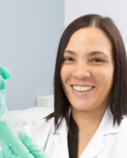{fig-align="left"}
:::

::: {.g-col-4}
[*Keynote Speaker*]{style="font-size: 0.8em"}  
**Dr. Lenine Liebenberg**  
Chief Researcher  
Centre for Epidemic Response and Innovation (CERI) - Stellenbosch  
Centre for the AIDS Programme of Research in South Africa (CAPRISA) - UKZN  
:::

::: {.g-col-2}
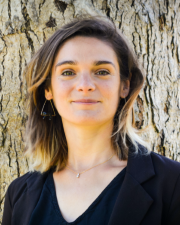{fig-align="left"}
:::
:::{.g-col-4}
[*Workshop Instructor*]{style="font-size: 0.8em"}  
**Dr. Laura Symul**  
Assistant Professor  
UCLouvain Institute of Statistics, Biostatistics and Actuarial Sciences
:::

::: {.g-col-2}
{fig-align="left"}
:::
::: {.g-col-4}
[*Workshop Instructor*]{style="font-size: 0.8em"}  
**Marothi Peter Letsoalo**  
Senior Biostatistician  
Centre for the AIDS Programme of Research in South Africa (CAPRISA) -  UKZN
:::

::: {.g-col-2}
{fig-align="left"}
:::
::: {.g-col-4}
[*Workshop Instructor*]{style="font-size: 0.8em"}  
**Salina Hussain**  
Research Technician  
Ragon Institute of MGB, MIT and Harvard
:::

::: {.g-col-2}
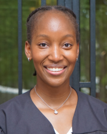{fig-align="left"}
:::
::: {.g-col-4}
[*Workshop Instructor*]{style="font-size: 0.8em"}  
**Suuba Demby**  
Research Technician  
Ragon Institute of MGB, MIT and Harvard
:::

::: {.g-col-2}
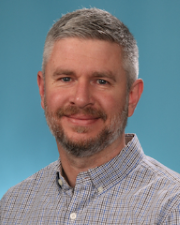{fig-align="left"}
:::
::: {.g-col-4}
[*Series Organizer and Instructor*]{style="font-size: 0.8em"}  
**Dr. Scott Handley**  
Professor  
Washington University School of Medicine  
Department of Pathology and Immunology
:::

::: {.g-col-2}
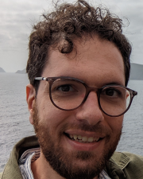{fig-align="left"}
:::
::: {.g-col-4}
[*Series Organizer and Instructor*]{style="font-size: 0.8em"}  
**Dr. Joseph Elsherbini**  
Data Scientist  
Ragon Institute of MGB, MIT and Harvard
:::

::: {.g-col-2}
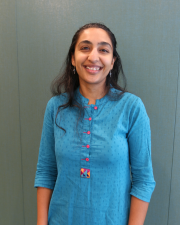{fig-align="left"}
:::
::: {.g-col-4}
[*Series Organizer and Instructor*]{style="font-size: 0.8em"}  
**Chandani Desai**  
Project Manager  
Ragon Institute of MGB, MIT and Harvard
:::

::: {.g-col-2}
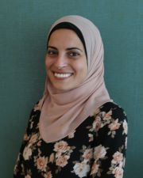{fig-align="left"}
:::

::: {.g-col-4}
[*Series Logistics and Management*]{style="font-size: 0.8em"}  
**Sarah Eisa**  
Program Manager  
Ragon Institute of MGB, MIT and Harvard
:::

::: {.g-col-2}
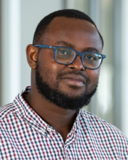{fig-align="left"}
:::

::: {.g-col-4}
[*Teaching Assistant*]{style="font-size: 0.8em"}  
**Derek Tshiabuila**  
PhD Research Fellow  
Centre for Epidemic Response and Innovation (CERI) - Stellenbosch  
:::

::: {.g-col-2}
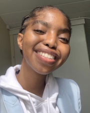{fig-align="left"}
:::

::: {.g-col-4}
[*Teaching Assistant*]{style="font-size: 0.8em"}  
**Asavela Kama**  
Bioinformatician  
Centre for the AIDS Programme of Research in South Africa (CAPRISA) -  UKZN
:::

::: {.g-col-2}
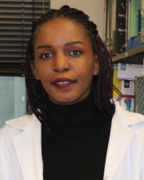{fig-align="left"}
:::

::: {.g-col-4}
[*Teaching Assistant*]{style="font-size: 0.8em"}  
**Afrah Khairallah**  
Postdoctoral research fellow
Africa Health Research Institute (AHRI) - UKZN  
:::

::: {.g-col-2}
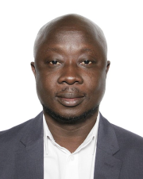{fig-align="left"}
:::

::: {.g-col-4}
[*Teaching Assistant*]{style="font-size: 0.8em"}  
**Kwabena Asare**  
Statistician  
Centre for the AIDS Programme of Research in South Africa (CAPRISA) -  UKZN
:::

::: {.g-col-2}
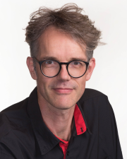{fig-align="left"}
:::

::: {.g-col-4}
[*Teaching Assistant*]{style="font-size: 0.8em"}  
**Johan van der Molen**  
Centre for the AIDS Programme of Research in South Africa (CAPRISA) - UKZN
:::

::: {.g-col-2}
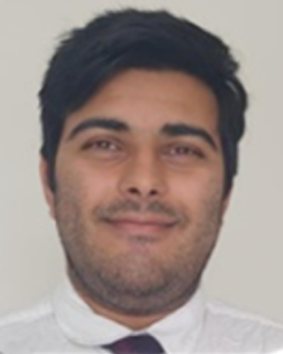{fig-align="left"}
:::

::: {.g-col-4}
[*Teaching Assistant*]{style="font-size: 0.8em"}  
**Wasim Abdool Karim**  
Bioinformatician
Centre for Epidemic Response and Innovation (CERI) - Stellenbosch  
:::

:::

### Workshop 2: High-Dimensional Data: The Human Microbiome

::: {.grid}

::: {.g-col-2}
{fig-align="left"}
:::
::: {.g-col-4}
[*Series Organizer and Instructor*]{style="font-size: 0.8em"}  
**Dr. Scott Handley**  
Professor  
Washington University School of Medicine  
Department of Pathology and Immunology
:::

::: {.g-col-2}
{fig-align="left"}
:::
::: {.g-col-4}
[*Series Organizer and Instructor*]{style="font-size: 0.8em"}  
**Dr. Joseph Elsherbini**  
Data Scientist  
Ragon Institute of MGB, MIT and Harvard
:::

::: {.g-col-2}
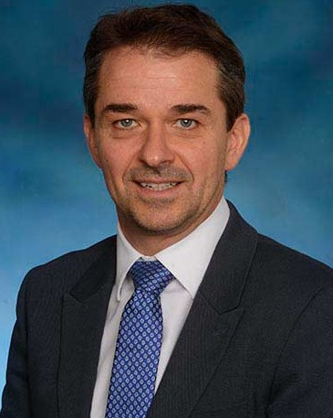{fig-align="left"}
:::
::: {.g-col-4}
[*Instructor*]{style="font-size: 0.8em"}  
**Dr. Jacques Ravel**  
Professor  
University of Maryland School of Medicine
Department of Microbiology and Immunology
:::

::: {.g-col-2}
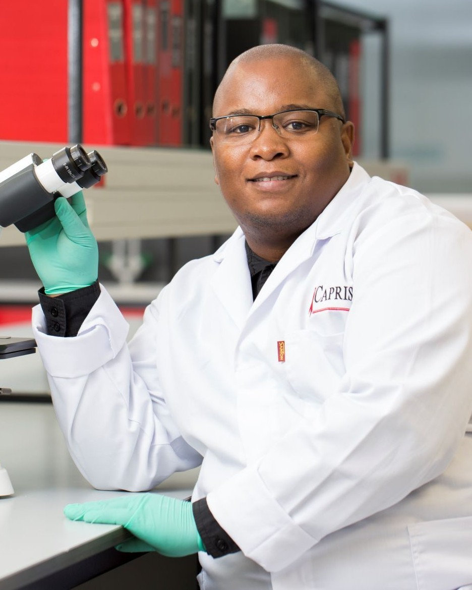{fig-align="left"}
:::
::: {.g-col-4}
[*Instructor*]{style="font-size: 0.8em"}  
**Dr. Sinaye Ngcapu**  
Senior Scientist \
CAPRISA \
HIV Mucosal Immunology Laboratory 
:::

::: {.g-col-2}
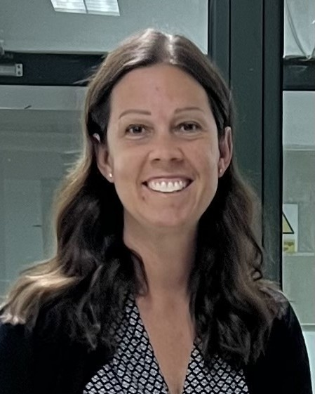{fig-align="left"}
:::
::: {.g-col-4}
[*Instructor*]{style="font-size: 0.8em"}  
**Lindsay Droit**  
Research Laboratory Manager
Washington University School of Medicine  
:::

::: {.g-col-2}
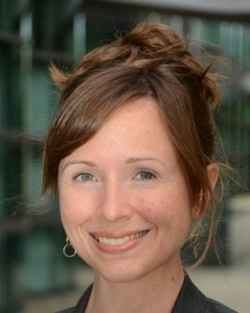{fig-align="left"}
:::
::: {.g-col-4}
[*Instructor*]{style="font-size: 0.8em"}  
**Dr. Elizabeth Costello**  
Research Scientist\
Stanford University
:::

::: {.g-col-2}
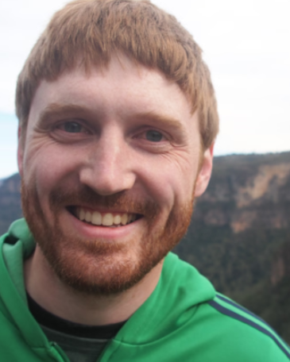{fig-align="left"}
:::
::: {.g-col-4}
[*Instructor*]{style="font-size: 0.8em"}  
**Dr. Michael France**  
Bioinformatician\
University of Maryland School of Medicine
:::

::: {.g-col-2}
{fig-align="left"}
:::
::: {.g-col-4}
[*Series Organizer and Instructor*]{style="font-size: 0.8em"}  
**Chandani Desai**  
Project Manager  
Ragon Institute of MGB, MIT and Harvard
:::

::: {.g-col-2}
{fig-align="left"}
:::

::: {.g-col-4}
[*Instructor*]{style="font-size: 0.8em"}  
**Asavela Kama**  
Bioinformatician  
Centre for the AIDS Programme of Research in South Africa (CAPRISA) -  UKZN
:::

::: {.g-col-2}
{fig-align="left"}
:::

::: {.g-col-4}
[*Instructor*]{style="font-size: 0.8em"}\
**Johnathan Shih**  
Bioinformatics \
Research Technician  
Ragon Institute of MGB, MIT and Harvard
:::

::: {.g-col-2}
{fig-align="left"}
:::

::: {.g-col-4}
[*Series Logistics and Management*]{style="font-size: 0.8em"}  
**Sarah Eisa**  
Program Manager  
Ragon Institute of MGB, MIT and Harvard
:::

::: {.g-col-2}
{fig-align="left"}
:::

::: {.g-col-4}
[*Series Logistics and Management*]{style="font-size: 0.8em"}  
**Renee Schumm**  \
Staff Assistant II  \
Ragon Institute of MGB, MIT and Harvard
:::

::: {.g-col-2}
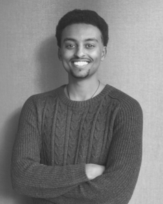{fig-align="left"}
:::
::: {.g-col-4}
[*Teaching Assistant*]{style="font-size: 0.8em"}  
**Aaron Abai**  
Research Technician  
Ragon Institute of MGB, MIT and Harvard
:::

::: {.g-col-2}
{fig-align="left"}
:::

::: {.g-col-4}
[*Teaching Assistant*]{style="font-size: 0.8em"}  
**Derek Tshiabuila**  
PhD Research Fellow  
Centre for Epidemic Response and Innovation (CERI) - Stellenbosch  
:::

::: {.g-col-2}
{fig-align="left"}
:::

::: {.g-col-4}
[*Teaching Assistant*]{style="font-size: 0.8em"}  
**Dr. Afrah Khairallah**  
Postdoctoral Research Fellow
Africa Health Research Institute (AHRI) - UKZN  
:::

::: {.g-col-2}
{fig-align="left"}
:::

::: {.g-col-4}
[*Teaching Assistant*]{style="font-size: 0.8em"}  
**Johan van der Molen**  
Centre for the AIDS Programme of Research in South Africa (CAPRISA) - UKZN
:::

::: {.g-col-2}
{fig-align="left"}
:::

::: {.g-col-4}
[*Teaching Assistant*]{style="font-size: 0.8em"}  
**Wasim Abdool Karim**  
Bioinformatician \
Centre for Epidemic Response and Innovation (CERI) - Stellenbosch  
:::

:::
